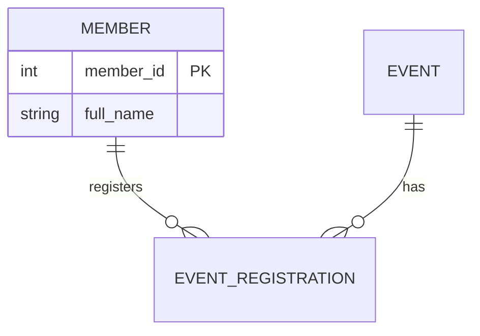

# Ödev 1: Kendi senaryon için ER diyagramı ve şema

**Son teslim:** 25 Ekim 2026 Pazar, 23:59
**Teslim:** Ödev 2 ile birlikte, tek Pull Request (aşağıda)
**Ağırlık:** Altı ödevden biri. Ödevler toplam notun %20'si; en düşük not atılır.
**Tahmini süre:** 2-3 saat

## Ne yapacaksın

Derste kulüp hikâyesiyle yaptığımız işi kendi senaryonla yapacaksın: önce ER diyagramını çiz, sonra onu PostgreSQL'de çalışan tablolara çevir.

Bu ödev ve Ödev 2, vize projenin ilk iki parçası. İkisini de aynı repoda yapıyorsun; vizeye kadar bu repo büyüyecek. Vize haftasında sıfırdan başlamayacaksın.

## Repo ve branch

Daha önce açmadıysan vize reposunu şimdi aç:

```bash
gh repo create come381-midterm-KULLANICIADI --private --add-readme --clone
cd come381-midterm-KULLANICIADI
git checkout -b week-05
```

Repo'nun Settings → Collaborators sayfasından `gizemturker`'ı ekle. Ödev 1 ve Ödev 2'nin hepsi `week-05` branch'inde yapılır.

## İstenenler

1. **Senaryo.** Hafta 2'de açtığın Issue'daki hikâyeyi kullan. Issue'ya yorum yazdıysam ona göre düzelt.
2. **`docs/er.md`:** Mermaid ile ER diyagramı. GitHub'da dosyayı açınca çizim olarak görünmeli. Varlıklar, ilişkiler ve kardinaliteler okunabilir olmalı.
3. **`sql/schema.sql`:** `CREATE TABLE` komutları.
   - En az 4 tablo
   - En az bir M:N ilişki (ara tablo ile)
   - Her tabloda primary key, ilişkilerde foreign key
   - Temiz bir veritabanında baştan sona hatasız çalışmalı
4. **`README.md`:** 3-5 cümle. Senaryonu ve verdiğin bir tasarım kararını anlat. Örneğin bir alt sınıf açtın mı, M:N ilişkiyi neden öyle kurdun?

Tablo ve sütun adlarını İngilizce ve `snake_case` yaz: `member`, `event`, `event_registration`, `start_date`.

Mermaid'in nasıl göründüğüne dair küçük bir örnek:

~~~markdown

~~~

## Göndermeden önce test et

```bash
dropdb --if-exists come381_test
createdb come381_test
psql -d come381_test -f sql/schema.sql
```

Hiç `ERROR` görmüyorsan tamam. Windows'ta komutlara `-U postgres` ekle.

## Yapay zeka

Kullandıysan repo kökündeki `AI_LOG.md` dosyasına `## Ödev 1` başlığı aç ve ne için kullandığını yaz. Ödev 1'de isteğe bağlı, Ödev 2'de zorunlu.

## Değerlendirme (100 puan)

| Ölçüt | Puan |
|---|---|
| ER diyagramı doğru ve okunaklı (varlık, ilişki, kardinalite) | 25 |
| Tablolara çeviri doğru (PK, FK, M:N için ara tablo) | 30 |
| `schema.sql` temiz bir veritabanında hatasız çalışıyor | 25 |
| Anahtar seçimi ve veri tipleri yerinde (`date`, `numeric`, `identity` vb.) | 10 |
| README notu ve commit geçmişi | 10 |

`NOT NULL`, `UNIQUE` ve `CHECK` constraint'lerini burada eklemek zorunda değilsin; Ödev 2'nin konusu tam olarak bu.

## Teslim

Ödev 1 ve Ödev 2'yi tek bir Pull Request olarak gönderiyorsun. Adımlar [Ödev 2'nin sonunda](odev-2.md#teslim).

## Yardım

Danışma saatleri: Salı 13:00-15:00, Cuma 12:00-14:00 (Dudullu Kampüsü)
E-posta: gturker@dogus.edu.tr (konu satırına "COME 381" ve GitHub kullanıcı adını yaz)
